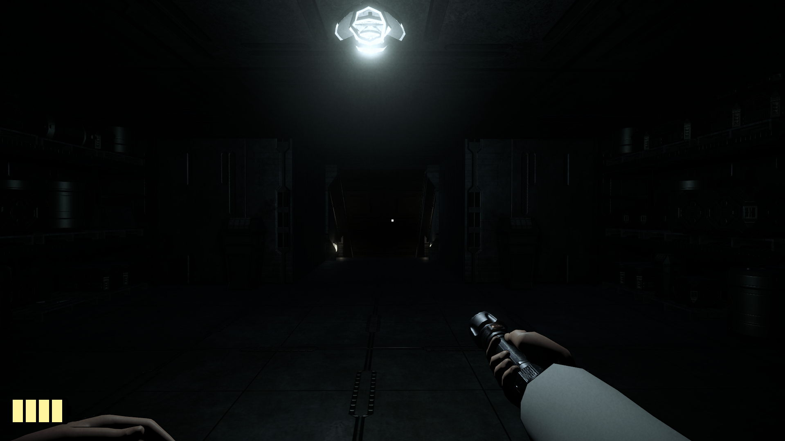
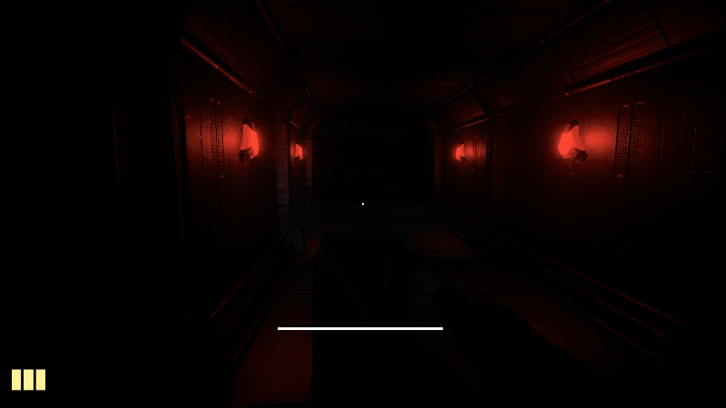
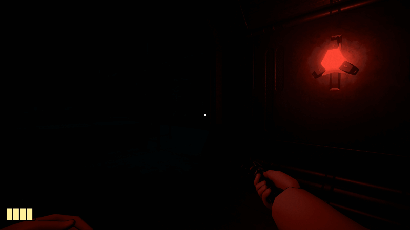
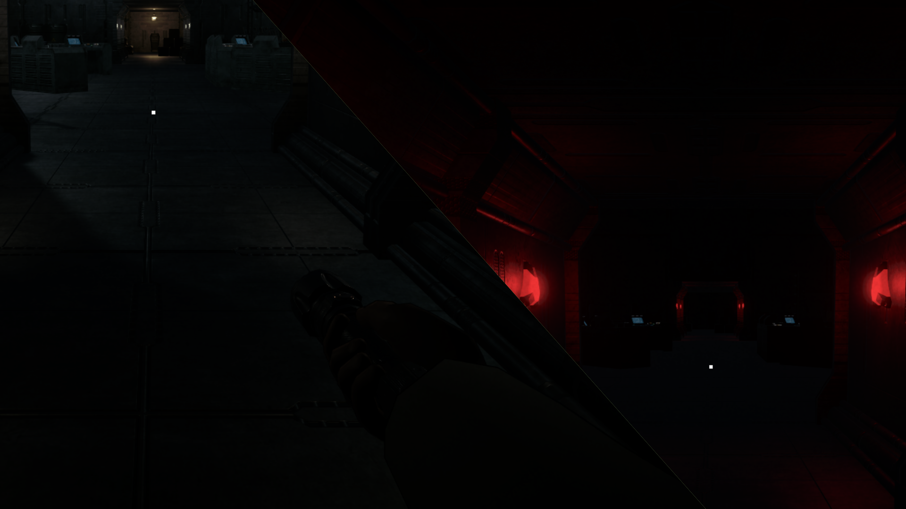
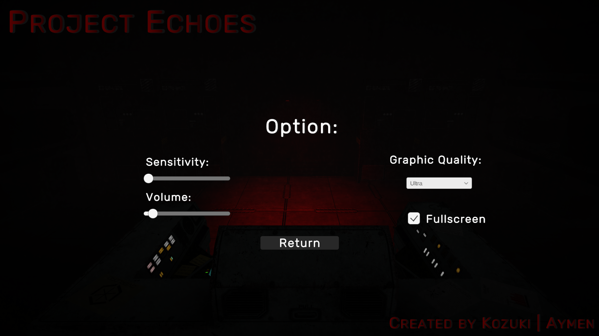

# Project Echoes — Sci-Fi Survival Horror Tech Demo



A first-person survival horror technical prototype developed with **Unity (Universal Render Pipeline)**. 
The project focuses on solid game architecture, finite state machines, decoupled event-driven systems, and dynamic rendering optimization in a claustrophobic industrial environment.

---

## Gameplay Overview

You are trapped in an abandoned subterranean industrial facility. A hostile creature roams the corridors, it may be blind, but sensitive to sound and direct light exposure.

* **Core Loop:** Locate and power down three primary generator terminals to lift the lockdown protocol on the main airlock.
* **Secondary Objective:** Retrieve the classified corporate folder before escaping.
* **Survival Mechanics:** Limited flashlight battery, stamina management, and throwable distractible objects (physics-driven sound emission).

---

## Key Technical Systems

### 1. Modular Enemy AI (State Machine & NavMesh)
The creature's behavior is driven by an explicit **Hierarchical Finite State Machine (HFSM)** decoupled from physics and animation layers:
* `SleepState`: Dormant in the containment room until facility security is breached (2 terminals down).
* `PatrolState`: Roams through random reachable NavMesh points with randomized idle wait timers.
* `InvestigateState`: Investigates acoustic disturbances triggered by player footsteps or physical props with an applied uncertainty radius.
* `ChaseState`: Roars, locks onto the target, switches to high-speed pathfinding, and executes an attack sequence when within catch range.
* `SearchState`: Performs local sweeping searches around the last known player position if visual contact is broken.

### 2. Event-Driven Decoupled Architecture (`GameEvents`)
To respect the **Single Responsibility Principle (SRP)** and eliminate tight coupling between managers and actors:
* Components communicate purely via static C# Actions (`OnTerminalActivated`, `OnNoiseEmitted`, `OnIlluminatingMonster`, `OnPlayerCaughtByMonster`).
* No direct hard references between interactive items, lighting triggers, narrative subtitles, and audio crossfaders.

### 3. Lighting & Dynamic Graphic Scaling (Forward+)
* **URP Forward+ Rendering Path:** Configured to handle numerous real-time local point lights without hitting the traditional 8-lights-per-object limit.
* **Runtime Quality Presets:** Custom URP assets allowing seamless switching between *Low*, *Medium*, *High*, and *Ultra* settings (adjusting shadow atlas resolutions, additional light shadow passes, and MSAA on the fly).
* **Decoupled Visual Feedback:** Dedicated `LightBlinker` component for smooth material emission syncing alongside light intensity pulses.

### 4. Physics & Interaction System
* Generic `IInteractable` interface for all world interactions (Pickups, Terminals, Physical throwables).
* Velocity-checked audio and acoustic trigger dampening on rigidbodies to prevent physics bounce spam.

---

## Media & Demonstrations

| AI Hearing & Noise Distraction | Flashlight Raycast Detection |
| :---: | :---: |
|  |  |

| Facility Light State | Game Settings |
| :---: | :---: |
|  |  |

---

## Project Structure

```text
Assets/
├── _Project/
│   ├── Animations/      # Monster and rig controllers
│   ├── Audio/           # Ambient loops, SFX, and spatial cues
│   ├── Materials/       # Custom post-processing and surface shaders
│   ├── Prefabs/         # Interactive objects, lights, and monster rig
│   ├── Scenes/          # MainMenu, Game
│   ├── Scripts/
│   │   ├── Core/        # Interfaces (IState, IInteractable)
│   │   ├── Enemy/       # States, Detection, Animation, Navigation
│   │   ├── Environment/ # LightBlinker, AlarmController
|   |   ├── Interaction/ # BatteryPickup, ThrowableObject, TerminalLogic
│   │   ├── Managers/    # GameManager, AudioManager, SubtitleManager
│   │   ├── Player/      # Movement, Look, Stamina, Input, States
|   |   └── UI/          # BatteryUI, StaminaBarUI, CrosshairUI
│   └── Settings/        # URP Assets (Low to Ultra), Input Actions
└── Art/                 # Modular environment kit and static 3D models
```

---
